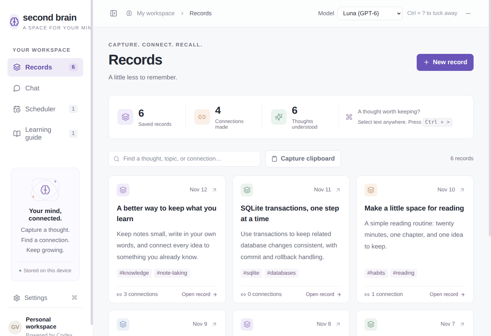
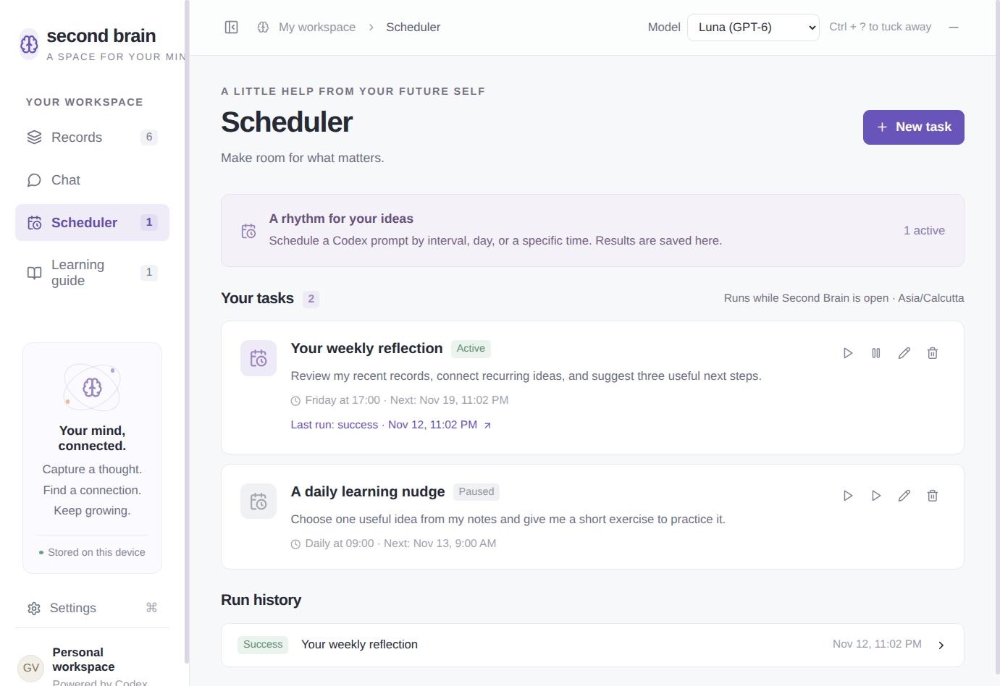
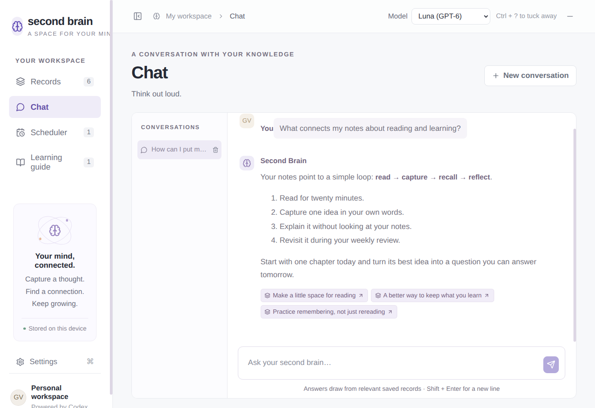
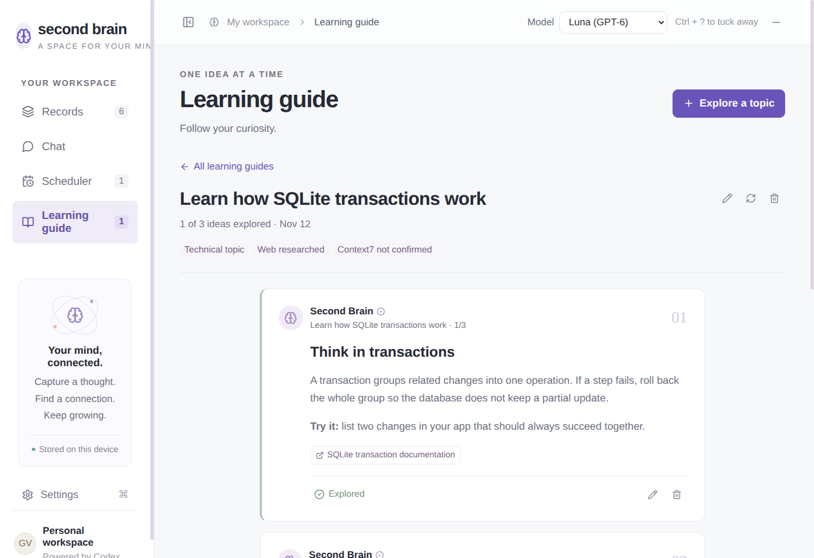
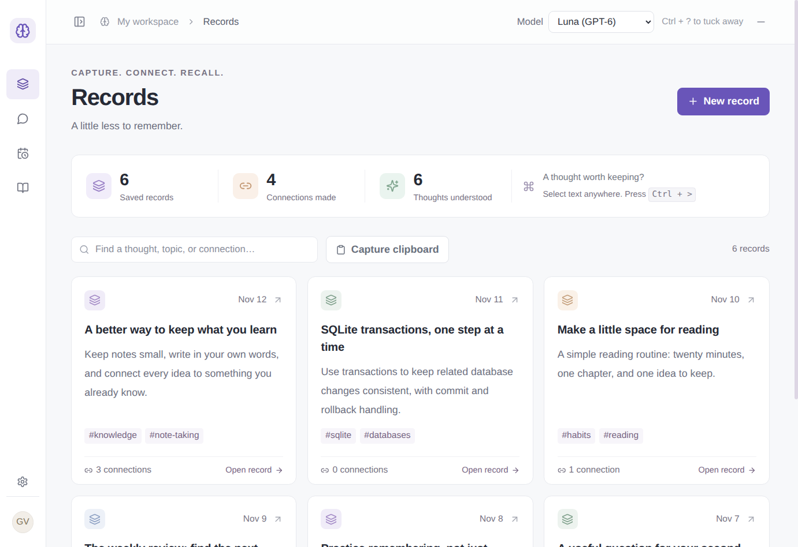
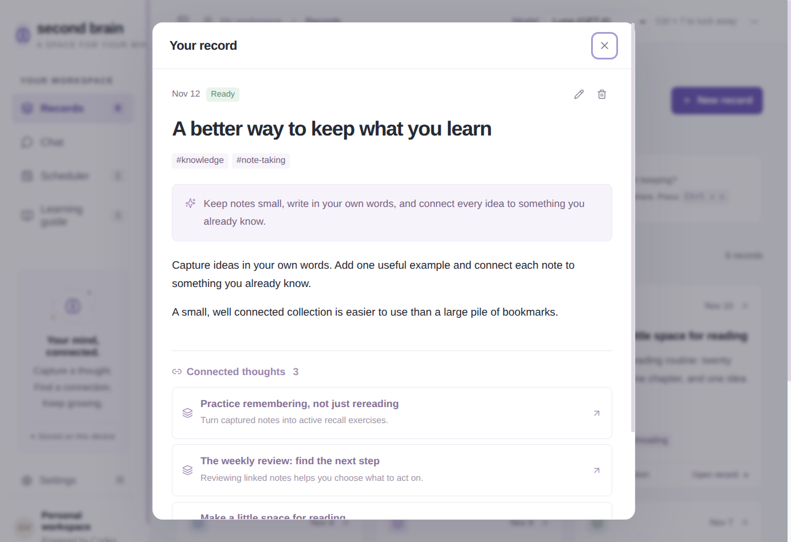

# Second Brain

An Electron companion with a draggable, always visible brain bubble, a React interface, and a local SQLite database. All language model work runs through your installed `codex exec` CLI and existing Codex login.

## Screenshots

Captured from the running Electron app with illustrative demonstration data. Personal records and conversations are not included.

### Records



| Scheduler | Chat with record citations |
| --- | --- |
| [](docs/screenshots/scheduler.png) | [](docs/screenshots/chat.png) |

| Learning cards | Collapsed sidebar |
| --- | --- |
| [](docs/screenshots/learning-guide.png) | [](docs/screenshots/collapsed-sidebar.png) |

<details>
<summary>Connected record detail and desktop bubble</summary>



The draggable bubble uses 70% opacity and keeps the full circle inside its window.


</details>

## Run

Requires Node.js 22.13 or newer, npm, a desktop session, and a working Codex CLI.

```sh
npm install
codex login
npm run build
npm start
```

For development, run `npm run dev`. On Linux, `npm run install:desktop` adds Second Brain to your application menu after building. `npm run dist` creates an unpacked Linux desktop distribution in `release/`.

Open **Settings** to set an absolute Codex executable path if desktop apps cannot find your shell's PATH. Luna (`gpt-6-luna`) is the default. Use the model selector in the top bar for any new request, or choose a default under Settings. The selector reads your Codex model catalog; Settings also accepts a custom model ID. The selection applies to records, chat, schedules, and learning guides. **Check saved connection** checks the CLI version and authentication status without making an LLM call.

## Start automatically on Linux

Enable the brain bubble at graphical login:

```sh
npm run install:startup
```

This installs a per-user XDG autostart entry at `~/.config/autostart/second-brain.desktop`. The bubble appears after login while the workspace stays hidden. Click the bubble or use Ctrl + ? to open it. Running a second background instance keeps the existing workspace hidden. Remove the autostart file to disable login startup. When registered as the Second Brain desktop app in LocalAM, a standalone startup instance also reports its PID to LocalAM so it can show running status and stop it. Instances already launched in a manager-owned process group keep the manager’s existing tracking.

If Ubuntu blocks Electron with a sandbox-helper or user-namespace error, install the app-specific AppArmor profile:

```sh
npm run install:sandbox
```

This validates the profile, requests administrator authentication through the system dialog, and installs `/etc/apparmor.d/second-brain` for this project's Electron and packaged executables. Electron's sandbox remains enabled. If you move the project, rerun both installers.

## Desktop companion

- Drag the brain bubble in any direction, to any screen edge or monitor; its position is remembered. Linux uses a dock-style companion window and full display bounds so the bubble can reach the system-bar area. The desktop controls whether its own panel draws above the bubble.
- The bubble tracks the native desktop cursor during a drag and keeps a fixed window size, including on displays with fractional scaling. Its transparent window cannot grow into an invisible overlay over the workspace.
- If you lose the bubble, use **Settings → Show / reset bubble** or the tray menu to reveal it on the current monitor.
- The bubble is 20% smaller, uses 70% opacity, and keeps its own zoom setting so workspace zoom cannot clip it.
- Text is one point larger than the previous default. Use **Ctrl + +** (or Ctrl + =) to increase text by one point, and **Ctrl + -** to decrease it. The setting is remembered and changes text without zooming the brain bubble.
- Toggle the sidebar with **Ctrl + E** or the sidebar button in the top bar. The collapsed menu keeps navigation icons available and remembers its state. While the app is focused, **Ctrl + 1** opens Records, **Ctrl + 2** Chat, **Ctrl + 3** Scheduler, and **Ctrl + 4** Learning guide.
- Click the bubble or press **Ctrl + Shift + /** (Ctrl + ? on a US keyboard) to expand or collapse the workspace.
- Select text in another app and press **Ctrl + Shift + .** (Ctrl + > on a US keyboard) to create a record immediately.
- Closing the main window keeps the bubble and scheduler running. Quit through the tray menu or Settings.
- On GNOME, Ctrl + ? and Ctrl + > are registered as desktop custom shortcuts so they work across native Wayland and X11 apps. They send commands to the running app through a private local socket. Existing custom shortcuts are preserved. Settings shows the shortcut backend and provides a Repair shortcuts button. The app must be running for the commands to work. Other desktops use Electron global shortcuts.
- On Linux, the app uses X11/XWayland for absolute window positioning and global shortcuts. An X server or XWayland is required. The launch scripts pass `--ozone-platform=x11` before Electron initializes; the app also restarts with that flag when launched directly. Linux uses software rendering to avoid GPU driver crashes affecting transparent windows. For a Wayland session, selection capture uses `wl-paste --primary` from **wl-clipboard**. Some applications do not expose primary selections; copy the text and use **Capture clipboard** instead. X11 sessions use the primary selection directly.
- On macOS, selection capture uses System Events to copy the current selection and may require Accessibility permission. Windows uses SendKeys. Applications that intercept copy, protected fields, and compositor restrictions can prevent capture. Shortcut registration status is shown in Settings.

## Four spaces

### Records

Create, read, edit, search, and delete text and image records. Paste images directly into the editor or attach up to six images. Images are converted to PNG and resized to at most 2400 pixels on their longest edge.

Original content is saved before Codex analysis. Codex reads the text and images, generates a title, summary and tags, and links genuinely related record IDs with a relationship explanation. Links can be followed in either direction. Use the left/right arrow keys or Previous/Next buttons to browse records. Failed analysis leaves the original intact and offers a retry. Edited records are analyzed again. The linking catalog includes the 200 newest other records; chat uses indexed retrieval rather than sending the whole library.

### Scheduler

Create interval, daily, weekly, or one-time schedules. Describe a schedule in natural language, review the parsed time and command, and save it. Tasks can be edited, paused, resumed, run immediately, or deleted. Every execution saves its result or error to run history.

Tasks are Codex assistant prompts, such as “summarize my recent notes,” with relevant records provided as context. They produce text results and can research the web. They do not run arbitrary shell scripts or perform external writes. The scheduler runs while the Electron process is alive, including when the main window is hidden. It does not wake a sleeping device or run after quitting. Overdue recurring tasks run once on reopening and advance to the next future occurrence. Times follow the device's local timezone. Up to two scheduled tasks run concurrently; each Codex invocation has a five-minute timeout.

### Chat

Ask questions grounded in saved records. SQLite FTS5 retrieves matching records, their direct connections, and recent context; the last 16 messages are included. Answers show clickable supporting records and distinguish missing knowledge. Conversations persist and can be deleted. Text from each retrieved record is limited to 8000 characters to keep context bounded.

### Learning guide

Enter a topic to generate a persistent feed of concise cards. Technical topics enable the public Context7 MCP endpoint alongside Codex live web search. Each card includes source links and can be edited, marked explored, or deleted. Guides can be renamed, regenerated, or deleted. Regeneration replaces the guide's cards and progress after successful generation.

The app checks the Codex event stream for completed web searches and Context7 calls. Generation fails with a retry option if no web search was observed. A technical guide generated without a successful Context7 call is explicitly labeled **Context7 not confirmed**, rather than claiming it was used. Context7 availability depends on the endpoint, rate limits, network, and your Codex configuration. Existing cards remain readable when offline.

## Data and architecture

Electron's main process owns SQLite, files, processes, shortcuts, scheduling and IPC. The sandboxed renderer uses a narrow preload bridge with context isolation and no Node access. Remote navigation and renderer-created windows are blocked; source links open in your system browser. Codex is launched using argument arrays, with a read-only workspace and structured JSON schemas; app code validates references and writes SQLite itself.

Data lives in Electron's per-user **Second Brain** application data directory (typically `~/.config/Second Brain` on Linux). Open it from Settings. It contains `brain.sqlite`, SQLite WAL files, image attachments, and an isolated Codex working directory. For a consistent backup, quit the app and copy the entire directory. `BRAIN_DATA_DIR=/absolute/path` selects a separate data directory for isolated use or development. Deleted or replaced image files may remain in the attachment directory; no automatic file cleanup is performed.

Storage is local and unencrypted. Using Codex sends the content needed for that request to the configured model provider; learning research also contacts web sources and Context7. The app does not require a separate OpenAI API key when your CLI is already authenticated.

## Checks

```sh
npm run check
npm test
npm run build
npm run test:desktop
```

The automated tests cover schedule validation, calendar boundaries, database persistence, full text search, linked records, deletion, transaction rollback, and recovery of interrupted runs. On Linux, the desktop integration check requires `xwininfo` (from x11-utils) to verify that the bubble is actually mapped on the desktop. The isolated desktop integration check verifies model selection reaches the Codex process and that the desktop command relay can reveal a hidden window. It uses a deterministic Codex fixture and exercises record processing, task results, chat citations, learning cards, CRUD, and navigation without touching your library. Live record analysis and web plus Context7 learning generation were also checked with the authenticated CLI during implementation. Desktop behavior and external service access also depend on your operating system and authenticated Codex installation.

Codex integration follows the official documentation for [non-interactive execution](https://learn.chatgpt.com/docs/non-interactive-mode) and [web search](https://learn.chatgpt.com/docs/web-search).
